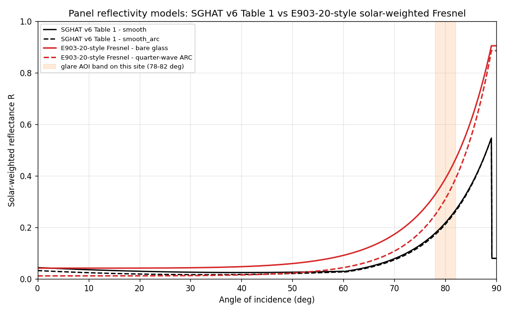

# รายงานการวิเคราะห์ความเสี่ยงแสงสะท้อน (Solar Glare Hazard Analysis) พื้นที่ท่าเรือสินค้า

**พื้นที่ศึกษา:** บริเวณท่าเรือ Map Ta Phut จ.ระยอง (พิกัดอ้างอิง **Onshore Connection Point** 12.6784035°N, 101.1167775°E, อ้างอิงในรูปทั้งหมด)
**เครื่องมือ:** โปรแกรมโอเพนซอร์สเท่านั้น ได้แก่ Python `pvlib-python` + การคำนวณเรขาคณิตสะท้อนแสงเอง และภาพ 3 มิติจาก matplotlib

**วันที่วิเคราะห์:** 28 กันยายน 2569 (การตั้งค่าล่าสุด: `groups=19`, `hit_test_mode="polygon"`, `reflectivity_mode="solar_weighted"` ตามขั้นตอน ASTM E903-20 กระจกเรียบ + ARC (`glass_type="smooth_arc"`), `atmospheric_attenuation="beer_lambert"` (V=20 กม.), `dni_mode="ineichen"`, การคำนวณแบบขนาน `n_workers=16`; วิเคราะห์ **6 กรณีออกแบบ** ผ่าน `site.cases` = **การกวาดมุมเอียง (tilt sweep) 10°/15°/20° × 2 ทิศหันแผง** ได้แก่ `az098_e903_t10/t15/t20` (แผงหัน ENE 98°) และ `az278_e903_t10/t15/t20` (แผงหัน W 278°) — ทุกกรณีใส่ **E903 solar-weighted ρ × Beer–Lambert attenuation** ซึ่งเป็นพลังงานที่ตาจริง ๆ ได้รับ)
---

## 1. วัตถุประสงค์

ประเมินว่าแผงผลิตไฟฟ้าพลังงานแสงอาทิตย์ (PV) ที่ติดตั้งในบริเวณท่าเรือจะก่อให้เกิดแสงสะท้อน (glare) ที่รบกวนการมองเห็นของเรือเดินสมุทรหรือไม่ ได้แก่ นายท้ายเรือ (captains), นายท่า/เจ้าหน้าที่นำร่อง (harbor pilots) และเจ้าหน้าที่ควบคุมจราจรทางน้ำ VTS (Vessel Traffic Service) เพื่อให้มั่นใจในความปลอดภัยทางทะเล โดยใช้เกณฑ์ของ Sandia National Laboratories / FAA และเพิ่มการประเมินผลกระทบทางชีวภาพตาม IEC 62471 — รอบนี้ทำ **การกวาดมุมเอียงแผง 3 ค่า** เพื่อประเมินว่าการปรับ tilt ใช้เป็นมาตรการบรรเทาได้ผลเพียงใด

## 2. ข้อมูลพื้นที่และจุดสังเกต

จุดสังเกต (receptors) ใช้ **พิกัดหน้างานจริง** จาก `config/important_receptors_location.txt` (จุดจริง สูง **40 ม. เหนือพื้นดิน**) — รวม **65 จุด** (จุดถนนสมมุติ `vehicle_1..3` เดิมถูกคอมเมนต์ออกจาก config แล้ว):

| กลุ่ม | รายละเอียด | จำนวน | ความสูง |
|---|---|---|---|
| เส้นทางเดินเรือ ฝั่งตะวันออก (**east 1**) | `east1_route_1` (แอ่งกลับเรือ/turning basin) → `east1_route_15` (จุดทอดสมอ): จุดหลัก 6 จุด + จุดกึ่งกลาง 9 จุด (เลื่อนขนานทั้งเส้นให้ route_1 ตรงกับแอ่งกลับเรือหน้างาน) | 15 | 40 ม. |
| เส้นทางเดินเรือ ฝั่งตะวันตก (**west 1–4**) | `west1_route_1..11`, `west2_route_1..11`, `west3_route_1..11`, `west4_route_1..11` (เริ่มจากปากอ่าวฝั่งตะวันตกเข้าสู่ท่าเรือ; แทรกจุดกึ่งกลางระยะห่าง ~2 กม. ระหว่างจุดหลักเดิม — จุดที่ 2..10 ของทุกเส้นเป็นจุดแทรก interpolation) | 44 | 40 ม. |
| จุดทอดสมอ/ท่าเทียบ | terminal_1, terminal_2, terminal_1_west (100 ม. ตะวันตกของ terminal_1), terminal_2_east (100 ม. ตะวันออกของ terminal_2) | 4 | 40 ม. |
| จุดสังเกตท่าเทียบ | obs_asia, obs_ptt | 2 | 40 ม. |

รวม **65 จุด** พิกัด PV-A เป็น **ตำแหน่งจริง** = จุดกึ่งกลางระหว่างจุดขึ้นฝั่ง (land) และจุดปลายท่อ/โครงสร้าง (end) หน้าท่า (ดูหัวข้อ 3)

> **หมายเหตุ:** วงแหวนสำรวจทิศทาง R2500_* (รัศมี 2,500 ม. รอบ PV-A, 8 จุด) เดิมเคยใช้ในรายงานฉบับก่อน ตอนนี้**ถูกคอมเมนต์ออกจาก `config/site.yaml`** แล้ว — เหลือใช้เฉพาะเป็นจุดตรวจ (QA) ใน `scripts/validate_charts.py` ไม่ใช่จุดสังเกตหน้างาน รายงานฉบับนี้ใช้จุดหน้างานจริง **65 จุด** เท่านั้น

*Figure 1 — Site map: PV array, the 65 receptor points (15 east + 44 west1–4 routes + 4 terminal + 2 observation) and the vessel routes near Map Ta Phut port (ผังพื้นที่เหมือนกันทุกกรณี เพราะตำแหน่งแผง/จุดสังเกตคงเดิม — ต่างกันเฉพาะมุมเอียงและทิศหัน).*


*สีกรอบสามเหลี่ยมจำแนกเส้นทางเดินเรือ: **west1 = teal**, **west2 = blue**, **west3 = violet**, **west4 = purple**, **east1 = olive** (สีเติมเขียว = จุดสังเกต); **obs_asia/obs_ptt** เป็นวงกลม กรอบดำ — (Vessel-route frame colours: west1 teal, west2 blue, west3 violet, west4 purple, east1 olive; observation points are circles with black frames.)*

*Figure 2a–2f — Site map coloured by annual glare minutes per receptor for each of the 6 cases (grey = 0 min; cool colour ramp, brighter = more glare minutes; values shown only where glare > 0). แถบบนซ้าย→ขวา = tilt 10°/15°/20° ของแผงหัน ENE, แถบล่างซ้าย→ขวา = tilt 10°/15°/20° ของแผงหัน W (แกน x/y คิดตามสัดส่วนระยะทางจริง)*


*Figure 3 — แผนที่**กลุ่ม (sub-panel) ของแผง PV-A ที่ทำให้เกิด glare ต่อ receptor** (groups=19, เรียงตามแกนยาวของแผง: group 0 = ปลายตะวันตก → group 18 = ปลายตะวันออก; สีอ้างอิงนาที glare ของ **receptor นั้น** ที่กลุ่มนั้นเป็นตัวชนะ (worst-wins) — เทา = ไม่มีนาทีที่กลุ่มนั้นชนะ; marker ของ receptor ที่พิจารณาถูกวงแหวนแดง). **az098:** obs_ptt โดนจากกลุ่ม **15–18** (t10: 76/187/129/97, t15: 243/123/100, t20: 239/132/99 นาที — ปลายตะวันออก), west1_route_11 โดนจากกลุ่ม **13–18** (t10: 115/65/50/41/45/35, t15: 65/85/60/45/43/38, t20: 130/65/45/48/39 นาที โดย t20 เริ่มที่กลุ่ม 14). **az278:** west1_route_1 โดนจากกลุ่ม **0–3** (t10: 34/24/33/61, t15: 77 ทั้งหมดที่กลุ่ม 0), west1_route_2 โดนจากกลุ่ม **0–1** (t10: 57/47 นาที)*


*Figure 4 — Annual sun path (solar azimuth vs. elevation) at the study site, computed with pvlib (NREL SPA), with hourly figure-8 (analemma) curves.*


## 3. การตั้งค่าแผง PV ในการวิเคราะห์

**6 กรณีออกแบบ = 2 ทิศหัน × 3 มุมเอียง** (เป้าหมายคือประเมินผลของ tilt เป็นมาตรการบรรเทา โดยคงตำแหน่ง ขนาด ความสูง และการแบ่งกลุ่มย่อยไว้เหมือนเดิมทุกกรณี):

| รหัส | รายละเอียด | tilt | azimuth | ค่าการสะท้อน | การลดทอนบรรยากาศ | label ใน `output/` |
|---|---|---|---|---|---|---|
| PV-A | Ground Array (พื้นที่ท่าเรือ) **2 × 4,890 ม.** (กว้าง 2 ม. × ยาวตามแนว land–end 4,890 ม. เดิม 4,883 ม.) สูงเหนือพื้น **12.5 ม.** แบ่งเป็น **19 กลุ่มย่อย** (กลุ่มละ 2 × ~257 ม.) | 10° | 98° (ENE) | Solar-weighted (ASTM E903-20 Fresnel, แผ่นกระจกเรียบ + ARC) | Beer–Lambert V = 20 กม. | `az098_e903_t10` |
| PV-A | (ตำแหน่ง/ขนาดเดิม) | 15° | 98° (ENE) | เหมือนกัน | เหมือนกัน | `az098_e903_t15` |
| PV-A | (ตำแหน่ง/ขนาดเดิม) | 20° | 98° (ENE) | เหมือนกัน | เหมือนกัน | `az098_e903_t20` |
| PV-A | (ตำแหน่ง/ขนาดเดิม) | 10° | 278° (W) | เหมือนกัน | เหมือนกัน | `az278_e903_t10` |
| PV-A | (ตำแหน่ง/ขนาดเดิม) | 15° | 278° (W) | เหมือนกัน | เหมือนกัน | `az278_e903_t15` |
| PV-A | (ตำแหน่ง/ขนาดเดิม) | 20° | 278° (W) | เหมือนกัน | เหมือนกัน | `az278_e903_t20` |

- ตำแหน่ง PV-A: **12.6561018°N, 101.1137274°E** = จุดกึ่งกลางระหว่างจุดขึ้นฝั่ง (land) กับจุดปลาย (end) หน้าท่า (ระยะ land–end ≈ 4,890 ม. เดิม 4,883 ม.)
- แต่ละกรณีใน `site.cases` จะ**บังคับ tilt และ azimuth** ของแผงทั้งหมด แล้วเก็บผลแยกโฟลเดอร์ `output/<label>/` (การเพิ่มกรณีทำได้โดยเพิ่มบรรทัดเดียวใน `config/site.yaml` ไม่ต้องแก้โค้ด; รันกรณีเดียวได้ด้วย `run_analysis.py --case <label>`)
- โหมดการสะท้อน `reflectivity_mode: "solar_weighted"` ใช้ค่า ρ ตามขั้นตอน solar weighting ของ **ASTM E903-20** (Fresnel ของกระจกหน้าแผง `glass_type="smooth_arc"` = แผ่นกระจกเรียบ + anti-reflection coating, ถ่วงน้ำหนักด้วยสเปกตรัม IEC 60904-3:2019 Table 1) แทนค่าคงที่ 0.08 — ที่ช่วงมุมที่เกิด glare จริงในการกวาดนี้ (AOI ~70–82°) ค่าการสะท้อนอยู่ที่ **ρ ≈ 0.12–0.38** และเป็นตัวแปรหลักที่ทำให้ผลต่างกันระหว่าง tilt
- การใช้ **19 กลุ่มย่อย** (กลุ่มละ 2 × ~257 ม. — เปลี่ยนจาก 18 กลุ่มเมื่อ 28 กันยายน 2569 ให้สอดคล้องกับผังโมดูลจริง) เพิ่มความละเอียดการตรวจจับในย่าน near/medium-field แต่**ความรุนแรง (G/Y/R) ไม่ขึ้นกับ `groups`** เพราะมุมย่อยแหล่งกำเนิด `x = min(β, θ)` คำนวณจาก **พื้นผิวสะท้อนต่อเนื่องทั้งหมด (`hazard_area`)** ไม่ใช่พื้นที่ของกลุ่มย่อย (ดูหัวข้อ 4–5) — จุดเดียวที่ `groups` ไปถึงตัวเลขคือค่า τ ของ Beer–Lambert ที่คำนวณที่ศูนย์กลางของกลุ่มย่อยที่ชนะ จึงทำให้ peak E_r ของทั้งปีขยับได้ไม่เกิน **0.2%** (การเปลี่ยน 18 → 19 กลุ่มทำให้ทุกจำนวนนาที จำนวน G/Y/R และกลุ่มความเสี่ยง IEC เหมือนเดิมทุกประการ)
- **ขั้นตอนทั้งหมดของ pipeline** (run_analysis → analyze_pair → _analyze_single → รวมผล → รูป) และการแมปฟังก์ชัน IEC 62471 ทีละข้อ/สมการ/หน้า: สรุปใน `output/analysis_steps_and_iec_mapping.md`

## 4. ระเบียบวิธีวิเคราะห์

การวิเคราะห์อ้างอิงระเบียบวิธีของ Sandia SGHAT (Ho et al., 2011, J. Sol. Energy Eng. 133:011011) ซึ่งเป็นโอเพนซอร์สและคำนวณเองทั้งหมด โดยมีขั้นตอนต่อ **525,600 นาที** ของปี (ทุกนาที) × ทุกคู่ (แผง, จุดสังเกต) = 65 คู่ × **6 กรณีออกแบบ** ดังนี้

1. **ตำแหน่งดวงอาทิตย์** คำนวณด้วย `pvlib.solarposition.get_solarposition` (NREL SPA) รายนาทีทั้งปี และค่า DNI ท้องฟ้าโปร่งด้วยโมเดล Ineichen
2. **เวกเตอร์สะท้อน** คำนวณจากเวกเตอร์ปกติของแผง (จาก tilt/azimuth) และทิศทางดวงอาทิตย์ ตามกฎการสะท้อน `r = 2(s·n)n − s`
3. **การตรวจพบ glare** ใช้ตัวตรวจจับ **รูปสี่เหลี่ยมจริง** (`hit_test_mode="polygon"`): ฉายขอบทั้ง 4 ของแผงผ่านจุดสังเกตขึ้นสู่ทรงกลมหน่วย สะท้อนกลับด้วยกระจกเงา แล้วตรวจว่าทิศดวงอาทิตย์ตกในรูปทรงกลม (spherical polygon) ที่ขยายขอบด้วยครึ่งมุมลำแสง (β/2 = มุมดวงอาทิตย์/2 + 6σ) หรือไม่ (ขอบสี่เหลี่ยมเป็นส่วนโค้ง great-circle ที่แม่นยำ)
4. **ผลกระทบต่อดวงตา** เมื่อพบ glare คำนวณ
   - มุมย่อยของแหล่งกำเนิด `x = min(β, θ)` เมื่อ `β = 9.3 mrad + 12σ` คือมุมลำแสง และ `θ = √(4·A·|cos θ_ref-pva|/π)/d` คือมุมจำกัดของพื้นที่แผงที่มองเห็นจริง (คิดการหดสั้นของพื้นที่เมื่อมองเฉียง) — โดยพื้นที่ `A` ใช้ **`hazard_area`** คือพื้นผิวสะท้อนต่อเนื่องทั้งหมดของผืนแผง (ไม่ใช่พื้นที่ของกลุ่มย่อย) เพราะแผงเรียบที่อยู่ในระนาบเดียวกันคือแหล่งกำเนิดแสงเดียว
   - ความเข้มแสงที่จอประสาทตา `E_r = E_c·(d_p²/(f²·x²))·τ` เมื่อ `d_p=2 mm`, `f=17 mm`, `E_c = DNI×reflectivity×τ` (reflectivity = ค่า E903 solar-weighted ตาม AOI; `τ = exp(−σ·d_km)` = ค่าการส่องผ่านบรรยากาศ Beer–Lambert ตามระยะเอียงถึงกลาง sub-panel — รายละเอียดด้านล่าง)
   - จำแนกตามเกณฑ์ Sandia: **Green** `E_r < 3.59e-5/x^1.77`, **Yellow** จนถึง **Red** `E_r ≥ 0.118/x` (x<0.118 rad) หรือ `1 W/cm²`

**การลดทอนบรรยากาศ Beer–Lambert** (`atmospheric_attenuation="beer_lambert"` — ใช้กับทั้ง 6 กรณี): คูณ `E_c` (และ `E_r`/G/Y/R/IEC t_max) ด้วย `τ = exp(−σ·d_km)` ต่อนาที โดย `d_km` = **ระยะเอียงจริงจากจุดรับถึงกึ่งกลาง sub-panel ที่เป็นผู้ชนะ** ตามแบบจำลองทัศนวิสัยผสม Kruse–Kim `σ = (3.91/V)(λ/550)^(−q)` [1/km] (`q` = 1.6 เมื่อ V>50, 1.3 เมื่อ 6<V≤50 (Kruse), `0.585·V^(1/3)` เมื่อ 1.2<V≤6, 0 เมื่อ V≤1.2 (Kim); `hazard.py::extinction_coefficient`/`atmospheric_transmittance`) ใช้ค่าเริ่มต้น `visibility_km: 20.0` (σ₅₅₀ ≈ 0.1955 km⁻¹ ≈ ฟ้าใส) — คอลัมน์ `atmos_transmittance` ใน detail CSV เก็บค่า τ ต่อนาที (1.0 เมื่อปิดโหมด) หมายเหตุ: **τ ขึ้นกับระยะเท่านั้น ไม่ขึ้นกับ tilt** ดังนั้นความต่างระหว่าง tilt ทั้งหมดมาจาก AOI/ρ, เวลา และฤดูกาลของนาทีที่ถูกชน — แต่เพราะระยะถูกวัดถึง **ศูนย์กลาง sub-panel ที่ชนะในแต่ละนาที** ค่า τ จึงขยับตามการแบ่งกลุ่มย่อยเล็กน้อย (การเปลี่ยนจาก 18 เป็น 19 กลุ่มทำให้ τ เปลี่ยนในหลักทศนิยมที่ 3–4 และเลื่อน peak E_r ของทั้งปีได้ไม่เกิน 0.2% โดยจำนวนนาทีและระดับ G/Y/R ไม่เปลี่ยน) — **รายงานฉบับนี้ใช้ผลที่มีบรรยากาศ (τ<1) เป็นผลหลัก** (พลังงานที่ตาจริง ๆ ได้รับ) ส่วนผลแบบไม่มีบรรยากาศ (ข้อตกลง SGHAT/FAA ที่ลำแสง collimated ไม่ลดตามระยะ) ให้เป็นเพียงขอบเขตบนแบบอนุรักษ์ที่บันทึกในหัวข้อ 5.5

*Reflectivity models vs angle of incidence (validation chart, `output/validation/e903_refl_compare.png`): SGHAT v6 Table 1 fits (black) vs E903-20-style solar-weighted Fresnel (red). ช่วง AOI ที่เกิด glare จริงในการกวาด tilt นี้คือ 70–82°.*



> **หมายเหตุ (การคำนวณแบบขนาน):** การวนกลุ่มย่อย (sub-panels) ของแต่ละคู่แผง–จุดใช้ thread pool (`environment.n_workers: 16`) — แต่ละ thread เป็น numpy vectorized ตลอดทั้งปี (ปล่อย GIL) ได้ผล bit-identical กับแบบ serial (ยืนยันด้วยการวัดจริง: เทียบ `n_workers: 16` กับ `n_workers: 1` บนจุดสังเกต `obs_ptt` ปี 2025 — `codes` ตรงกันครบทั้ง 525,600 ขั้นเวลา และ `detail` ตรงกันครบทุกคอลัมน์) ทำให้ `run_analysis.py` รันครบทั้ง 6 กรณี (6×65 คู่) เสร็จใน **~11 นาที** (~107–120 วินาที/กรณี โดยเปิด profiling ด้วย)

> **หมายเหตุ (โปรไฟล์การทำงาน):** ทุกกรณีบันทึก "ต้นทุนเวลา" ของแต่ละขั้นตอนไว้ใน `output/<label>/results/run_profile.csv` และกราฟ `14_run_profile.png` (แผนภาพ 4 ส่วน: เวลารวมแยกตามเฟส, เวลาสุทธิรายฟังก์ชัน, แผนผังงานขนานบนแต่ละ thread, ตารางผลลัพธ์หลักที่ยังไม่ถูกบันทึกที่อื่น) และสรุปรวมทั้งชุดไว้ที่ `output/run_profile_all_cases.csv` — เป็นการวัดเวลาเท่านั้น (opt-in) ไม่กระทบผลลัพธ์ทางฟิสิกส์: ตรวจยืนยันแล้วว่าไฟล์ผลลัพธ์ทั้ง 27 ไฟล์ของทั้ง 6 กรณี **bit-identical** ก่อน–หลังเปิดโปรไฟล์ และ parity test ที่ `n_workers: 16` กับ `n_workers: 1` ยังผ่าน (`detail` ตรงกันครบ 31 คอลัมน์ 489 แถว)

> **หมายเหตุ (การตรวจพบ glare เพิ่มเติม):** เพื่อตัดกรณีร่อแร่ (degenerate grazing) ที่ดวงอาทิตย์จ่ออยู่บนระนาบแผงพอดี มักตรวจพบเพิ่มเติมด้วยเงื่อนไข **จานอาทิตย์ทั้งใบต้องอยู่เหนือระนาบแผง** (`s·n > sin(β/2)`) และมีค่า DNI ขั้นต่ำ `environment.min_dni_wm2` (ค่าเริ่มต้น 10 W/m², ตั้ง 0 = ปิด) — เงื่อนไขเหล่านี้เป็นข้อกำหนดเสริมที่ SGHAT v6 ต้นฉบับไม่มี แต่ตัด false positive ที่ไม่มีความหมายทางฟิสิกส์ออก (ยืนยันใน `sanity_checks.py::test_front_face_sun_disc_guard`; กรณีผลลัพธ์ของรายงานนี้ไม่ถูกกระทบ)

### เกณฑ์ระดับความเสี่ยง (Sandia/FAA ocular impact levels)

| สี | ความหมาย | ผลต่อการเดินเรือ |
|---|---|---|
| **Green** | Low hazard (ผ่านเกณฑ์) | เสี่ยงต่ำ ไม่ขัดขวางการมองเห็น |
| **Yellow** | Potential temporary after-image | ต้องบรรเทา/หลีกเลี่ยง เพราะอาจบดบังไฟนำร่องและสัญญาณ |
| **Red** | Potential permanent retinal damage | ห้ามโดยเด็ดขาด |

## 5. ผลการวิเคราะห์

### 5.1 สรุปภาพรวมทั้ง 6 กรณี

ผลรวมนาทีที่มีแสงสะท้อนต่อปี แบ่งตามระดับความเสี่ยง สำหรับการวิเคราะห์รายนาทีของปี 2025 (`groups=19`, `hit_test_mode="polygon"`, `reflectivity_mode="solar_weighted"` (E903-20 Fresnel, `glass_type="smooth_arc"`) × `atmospheric_attenuation="beer_lambert"` (V=20 กม.), hazard คำนวณจาก `hazard_area`):

| กรณี | tilt | จุดที่ได้รับผล | Green | Yellow | Red | นาที glare | peak retinal (W/cm²) | x (mrad) | IEC 62471 (สูงสุด) | min t_max_thermal (s) |
|---|---|---|---|---|---|---|---|---|---|---|
| `az098_e903_t10` | 10° | obs_ptt, west1_route_11 | 0 | 840 | 0 | **840** (14.0 ชม.) | **1.109** (obs_ptt) | β = 9.30 | **RG3** | **0.019** |
| `az098_e903_t15` | 15° | obs_ptt, west1_route_11 | 0 | 802 | 0 | **802** (13.4 ชม.) | **0.826** (obs_ptt) | β = 9.30 | **RG3** | **0.063** |
| `az098_e903_t20` | 20° | obs_ptt, west1_route_11 | 0 | 797 | 0 | **797** (13.3 ชม.) | **0.569** (obs_ptt) | β = 9.30 | **RG2** | **0.281** |
| `az278_e903_t10` | 10° | west1_route_1, west1_route_2 | 152 | 104 | 0 | **256** (4.3 ชม.) | **0.959** (route_2) | θ = 3.25 | **RG2** | **144** |
| `az278_e903_t15` | 15° | west1_route_1 | 77 | 0 | 0 | **77** (1.3 ชม.) | **0.440** (route_1) | θ = 3.52 | **RG1** | **1852** |
| `az278_e903_t20` | 20° | — | 0 | 0 | 0 | **0** | — | — | Exempt | — |

- **ไม่พบ Red ในทุกกรณี** และ 63 จุดจาก 65 (east1 15, west 42, terminal 4, obs_asia) เป็น 0 นาที/ปี ในทุกกรณี — ความเสี่ยงกระจุกอยู่ที่ `obs_ptt` + ปลายสุดของเส้นทาง west1 (ฝั่ง ENE) หรือสองจุดแรกของ west1 (ฝั่ง W) เท่านั้น
- **ผลรวมทั้ง 6 กรณี: Yellow 2,543 นาที/ปี (ฝั่ง ENE 2,439 + ฝั่ง W 104) + Green 229 นาที/ปี (ฝั่ง W ทั้งหมด) + Red 0**
- **ข้อสรุปสำคัญของการกวาด tilt:** การเพิ่มมุมเอียง **ลดความรุนแรงได้มาก แต่ลด "จำนวนนาทีที่เกิด glare" ได้น้อย** — ฝั่ง ENE ลดแค่ 840 → 802 → 797 นาที (−5%) แต่ peak ลด 1.109 → 0.826 → 0.569 W/cm² (−49%) และ IEC ลดจาก RG3 เป็น RG2; ฝั่ง W ลดมากกว่า (256 → 77 → 0 นาที) เพราะ tilt ระดับ 20° ดันลำแสงสะท้อนออกจากกรอบการตรวจพบของจุดไกลฝั่งตะวันตกทั้งหมด (หัวข้อ 5.4)
- ทุกกรณีตรวจสอบผ่าน `scripts/validate_e903.py` [D] (78 checks) ซึ่งยืนยันว่า G/Y/R ตรงกับผลรัน, `E_c = DNI/1e4·ρ·τ` และ `E_r = E_c·(d_p/f)²/x²·0.5` (ตัวคูณ 0.5 คือสัดส่วนรังสีที่ผ่านเข้าจอประสาทตา `OCULAR_TRANSMISSION` ตาม Ho 2011 — ทำให้ค่าจานอาทิตย์อ้างอิงได้ ≈ 8 W/cm²) ตรงกันทุกนาที (max rel err ~1e-13) และ `0 < τ ≤ 1` ทุกแถว

### 5.2 กรณีฝั่งตะวันออกเฉียงเหนือ — แผงหัน ENE ~98° (az098, tilt 10/15/20°)

#### 5.2.1 tilt 10° — `az098_e903_t10` (กรณีอ้างอิงเดิม)

| จุดสังเกต | แผง | Green | Yellow | Red | minutes | peak retinal irradiance (W/cm²) |
|---|---|---|---|---|---|---|
| obs_ptt (จุดสังเกตท่าเทียบ พตท.) | PV-A | 0 | 489 | 0 | 489 | **1.109** |
| west1_route_11 (เส้นทางเดินเรือฝั่งตะวันตก, จุดท้ายสุดของเส้น) | PV-A | 0 | 351 | 0 | 351 | **0.602** |
| อีก 63 จุด | PV-A | 0 | 0 | 0 | 0 | — |
| **รวม** | | **0** | **840** | **0** | **840** | — |

- **obs_ptt** 489 นาที/ปี: ช่วงเย็น **16:00–17:00 น.** ฤดู มี.ค.–ต.ค. (มี.ค. 49, เม.ย. 78, พ.ค. 72, มิ.ย. 71, ก.ค. 77, ส.ค. 72, ก.ย. 66, ต.ค. 4) — จุดรุนแรง 2025-03-10 17:00 (sun az 261° el 20.0°, AOI 79.6°, ρ(E903 smooth_arc)≈0.322, DNI ≈ 596 W/m², τ = **0.721** @ 1.67 กม.), peak **1.109 W/cm²**, x = β = 9.3 mrad (จานอาทิตย์)
- **west1_route_11** 351 นาที/ปี: ช่วงเย็น **16:00–17:00 น.** (เน้น 17:00) ฤดู **เม.ย.–ก.ย.** (เม.ย. 55, พ.ค. 69, มิ.ย. 71, ก.ค. 69, ส.ค. 73, ก.ย. 14) พบครั้งแรก 2025-04-05 17:00 ครั้งสุดท้าย 2025-09-07 16:56 — จุดท้ายสุดของเส้นทางเข้าท่าเรือฝั่งตะวันตก west1 (เดิมชื่อ `west1_route_5` ถูกเรียงเลขใหม่เป็น `west1_route_11` เมื่อแทรกจุดกึ่งกลาง ~2 กม.) อยู่ห่างจากแผง ~4.8 กม. มองเห็นแผงในมุม AOI ~80° ช่วงบ่าย → รังสีสะท้อนไปทางทิศตะวันออก-ใต้เข้าหาจุดนี้ จุดรุนแรง 2025-04-27 17:02 (AOI ≈ 79.9°, ρ≈0.333, τ = **0.388** @ 4.84 กม.), peak **0.602 W/cm²**; จุดก่อนหน้า `west1_route_10` (ระยะไล่ ~3.6 กม.) เป็น 0 → โซน glare ยามเย็นจำกัดอยู่บริเวณปลายสุดเส้นทาง

*Figure 5a/6a — Glare occurrence (month vs. hour, 30-min) and daily duration (min/day, stacked by IEC RG) for obs_ptt (az098_e903_t10: Y 489 นาที/ปี).*


*Figure 5b/6b — Same for west1_route_11 (az098_e903_t10: Y 351 นาที/ปี).*


#### 5.2.2 tilt 15° — `az098_e903_t15`

| จุดสังเกต | แผง | Green | Yellow | Red | minutes | peak retinal irradiance (W/cm²) |
|---|---|---|---|---|---|---|
| obs_ptt | PV-A | 0 | 466 | 0 | 466 | **0.826** |
| west1_route_11 | PV-A | 0 | 336 | 0 | 336 | **0.447** |
| อีก 63 จุด | PV-A | 0 | 0 | 0 | 0 | — |
| **รวม** | | **0** | **802** | **0** | **802** | — |

- **obs_ptt** 466 นาที/ปี: เย็น **16:00–17:00 น.** (เน้น 16:00 ช่วง 16:01–16:30) ฤดู มี.ค.–ก.ย. (มี.ค. 40, เม.ย. 66, พ.ค. 73, มิ.ย. 72, ก.ค. 76, ส.ค. 73, ก.ย. 66) — จุดรุนแรง 2025-03-14 16:21 (sun az 259.9° el 29.5°, **AOI 74.9°**, ρ≈**0.197**, DNI ≈ 725 W/m², τ = **0.721**), peak **0.826 W/cm²**; **ไม่มีต.ค. แล้ว** (เทียบ tilt 10° ที่ยังมี 4 นาทีในต.ค.)
- **west1_route_11** 336 นาที/ปี: เย็น **16:00–17:00 น.** (เน้น 16:00 ช่วง 16:17–16:32) ฤดู เม.ย.–ก.ย. (เม.ย. 46, พ.ค. 70, มิ.ย. 73, ก.ค. 68, ส.ค. 73, ก.ย. 6) พบครั้งแรก 2025-04-08 16:20 ครั้งสุดท้าย 2025-09-03 16:18 — จุดรุนแรง 2025-04-09 16:21 (AOI ≈ 75.0°, ρ≈**0.200**, τ = **0.388**), peak **0.447 W/cm²**

*Figure 5c/6c — Glare occurrence and daily duration for obs_ptt (az098_e903_t15: Y 466) and west1_route_11 (az098_e903_t15: Y 336).*


#### 5.2.3 tilt 20° — `az098_e903_t20`

| จุดสังเกต | แผง | Green | Yellow | Red | minutes | peak retinal irradiance (W/cm²) |
|---|---|---|---|---|---|---|
| obs_ptt | PV-A | 0 | 470 | 0 | 470 | **0.569** |
| west1_route_11 | PV-A | 0 | 327 | 0 | 327 | **0.301** |
| อีก 63 จุด | PV-A | 0 | 0 | 0 | 0 | — |
| **รวม** | | **0** | **797** | **0** | **797** | — |

- **obs_ptt** 470 นาที/ปี: บ่าย **15:00–16:00 น.** (ช่วง 15:23–15:47) ฤดู มี.ค.–ก.ย. (มี.ค. 36, เม.ย. 69, พ.ค. 79, มิ.ย. 73, ก.ค. 81, ส.ค. 74, ก.ย. 58) — จุดรุนแรง 2025-03-16 15:42 (sun az 257.4° el 38.9°, **AOI 70.1°**, ρ≈**0.123**, DNI ≈ 799 W/m², τ = **0.721**), peak **0.569 W/cm²**; **ไม่มีต.ค.** และช่วงเวลาเลื่อนขึ้นจาก 16:xx (tilt 10/15°) เป็น 15:xx ตามการเอียงแผง
- **west1_route_11** 327 นาที/ปี: บ่าย **15:00–16:00 น.** (ช่วง 15:37–15:50) ฤดู **เม.ย.–ส.ค.** (เม.ย. 44, พ.ค. 70, มิ.ย. 73, ก.ค. 71, ส.ค. 69) พบครั้งแรก 2025-04-11 15:39 ครั้งสุดท้าย 2025-08-31 15:39 — จุดรุนแรง 2025-04-13 15:40 (AOI ≈ 70.0°, ρ≈**0.123**, τ = **0.388**), peak **0.301 W/cm²**; **หมดเดือน ก.ย.** ที่ tilt 10/15° ยังมี (tilt 10°: 14 นาที, tilt 15°: 6 นาที)

*Figure 5d/6d — Glare occurrence and daily duration for obs_ptt (az098_e903_t20: Y 470) and west1_route_11 (az098_e903_t20: Y 327).*


### 5.3 กรณีฝั่งตะวันตก — แผงหัน W ~278° (az278, tilt 10/15/20°)

#### 5.3.1 tilt 10° — `az278_e903_t10` (กรณีอ้างอิงเดิม)

| จุดสังเกต | แผง | Green | Yellow | Red | minutes | peak retinal irradiance (W/cm²) |
|---|---|---|---|---|---|---|
| west1_route_1 (เส้นทางเดินเรือฝั่งตะวันตก, จุดแรก) | PV-A | **152** | 0 | 0 | 152 | **0.847** |
| west1_route_2 (เส้นทางเดินเรือฝั่งตะวันตก, จุดแทรก ~2 กม. จากจุดแรก) | PV-A | 0 | **104** | 0 | 104 | **0.959** |
| อีก 63 จุด | PV-A | 0 | 0 | 0 | 0 | — |
| **รวม** | | **152** | **104** | **0** | **256** | — |

- พบ glare **2 จุด** — **`west1_route_1`** (จุดแรกฝั่งตะวันตก lon ≈ 100.976°E, ~15.6 กม.) เป็น **Green 152 นาที/ปี** เพราะ τ ≈ 0.047 ที่ระยะไกลกด `E_r` ต่ำลงใต้เกณฑ์ afterimage (≈ 1.20 W/cm² ที่ x = 2.78 mrad) ส่วน **`west1_route_2`** (~13.4 กม.) เป็น **Yellow 104 นาที/ปี** (0.959 W/cm² ยังเกินเกณฑ์ afterimage ≈ 0.91 W/cm² ที่ x = 3.25 mrad) — ไม่มี Red
- ขอบเขตผล (เส้นทาง): ช่วงเช้า **07:11–07:23 น.** **west1_route_1** ฤดู **พ.ค.–ก.ค.** (พ.ค. 26, มิ.ย. 70, ก.ค. 56 นาที) **west1_route_2** ฤดู พ.ค.–ก.ค. (พ.ค. 4, มิ.ย. 69, ก.ค. 31 นาที) เช้าประมาณ **07:11–07:20 น.** — โซน glare เข้าทิศนี้ทอดจากปลายสุด west1 ทิศตะวันตกเข้าไปอีก ~2–3 กม. แล้วหมดที่ `west1_route_3` (12.5 กม.) = 0
- peak อันรุนแรงสุดของกรณี: **`west1_route_1` — 2025-06-14 07:11 น.** (AOI 81.3°, ρ≈0.384, τ = **0.047** @ 15.55 กม.) ค่า peak **0.847 W/cm²** ที่ **x = θ = 2.78 mrad** (จุดไกล → มุมย่อยแหล่งกำเนิดถูกจำกัดด้วยมุมเชิงมุมของแผง ซึ่งเล็กกว่าจานอาทิตย์ β = 9.3 mrad มาก → ภาพเรตินาแหลม) — เทียบเกณฑ์ burn ที่ x นี้ (0.118/0.00278 ≈ **42.5 W/cm²**) คิดเป็น ~2% ของเกณฑ์ burn; **west1_route_2** peak 0.959 W/cm² ที่ x = θ = 3.25 mrad (2025-06-19 07:12, τ = 0.073 @ 13.41 กม.)
- กลไก: แผงหันเกือบตะวันตก (278°) — พระอาทิตย์เช้า (ทิศตะวันออก az ~70–120°) สะท้อนไปทาง**ตะวันตก**เข้าหาเส้นทางฝั่งตะวันตก (west1_route_1/2) เฉพาะช่วงเช้าตรู่เดือน พ.ค.–ก.ค. เท่านั้น

*Figure 5e/6e — Glare occurrence and daily duration for west1_route_1 (G 152 นาที/ปี, peak 0.847 W/cm²) และ west1_route_2 (Y 104 นาที/ปี, peak 0.959 W/cm²) — az278_e903_t10.*


#### 5.3.2 tilt 15° — `az278_e903_t15`

| จุดสังเกต | แผง | Green | Yellow | Red | minutes | peak retinal irradiance (W/cm²) |
|---|---|---|---|---|---|---|
| west1_route_1 | PV-A | **77** | 0 | 0 | 77 | **0.440** |
| อีก 64 จุด (รวม west1_route_2) | PV-A | 0 | 0 | 0 | 0 | — |
| **รวม** | | **77** | **0** | **0** | **77** | — |

- พบ glare **1 จุด** — `west1_route_1` เป็น **Green 77 นาที/ปี** ทั้งหมดอยู่ใน **เดือน มิ.ย.–ก.ค.** (มิ.ย. 60, ก.ค. 17; พ.ค. = 0) ช่วงเช้า **07:52–07:59 น.** — `west1_route_2` หลุดเป็น 0 นาที
- จุดรุนแรง 2025-06-15 07:52 (sun az 70.1° el 26.9°, **AOI 76.6°**, ρ≈**0.235**, τ = **0.0505** @ 15.55 กม.), peak **0.440 W/cm²** ที่ **x = θ = 3.52 mrad** — เทียบเกณฑ์ burn ที่ x นี้ ≈ 33.5 W/cm² คิดเป็น ~1% ของเกณฑ์ burn และต่ำกว่าเกณฑ์ afterimage (≈ 0.79 W/cm²) → Green ทั้ง 77 นาที

*Figure 5f/6f — Glare occurrence and daily duration for west1_route_1 — az278_e903_t15 (G 77 นาที/ปี, peak 0.440 W/cm², มิ.ย.–ก.ค. เช้า 07:52–07:59).*


#### 5.3.3 tilt 20° — `az278_e903_t20`

| จุดสังเกต | แผง | Green | Yellow | Red | minutes | peak retinal irradiance (W/cm²) |
|---|---|---|---|---|---|---|
| ทั้ง 65 จุด | PV-A | 0 | 0 | 0 | **0** | — |
| **รวม** | | **0** | **0** | **0** | **0** | — |

- **ไม่พบแสงสะท้อนที่จุดสังเกตใดเลยตลอดทั้งปี (0 นาที/ปี ทั้ง 65 จุด)** — IEC 62471: Exempt ทุกจุด
- เหตุผลเชิงกลไก: การเอียงแผง 20° ทำให้เวกเตอร์ปกติเอียงจากแนวตั้งมากขึ้น ทำให้ **ลำแสงที่สะท้อนตอนเช้ายกขึ้นเหนือระดับสายตาของจุดสังเกตที่อยู่ไกล 13–16 กม.** (จุดเหล่านี้อยู่ใกล้ระดับน้ำทะเล) — จุดใกล้แผงไม่เกิด glare อยู่แล้วในทิศ W จึงเหลือเพียง 0 นาที
- เนื่องจากไม่มีนาที glare รูปประกอบเฉพาะกรณี (Figure 3, 5, 6, 10, 11, 13) จึงไม่ถูกสร้างโดย pipeline — คงไว้เฉพาะ Figure 1/2/4/7/8/9/12 (โครงสร้างแผง, แผนที่, แผนภาพท้องฟ้า, สรุปภาพรวม, แผนที่ ocular, ตำแหน่งดวงอาทิตย์ และฟังก์ชันถ่วงน้ำหนัก IEC)

### 5.4 ผลของการเพิ่มมุมเอียง (tilt) ในเชิงกลไก

การเพิ่ม tilt จาก 10° → 15° → 20° **ไม่ได้เปลี่ยน "ว่าจุดใด/ช่วงเวลาใดถูกชน" มากนัก แต่เปลี่ยน "ความเข้มแสงที่ตาได้รับ" ลงมาก** เพราะทิศตกของรังสีสะท้อนถูกกำหนดด้วย azimuth เป็นหลัก ส่วน tilt กำหนด **มุม incidence (AOI)** ซึ่งเป็นตัวแปรที่ผลักคูณกำลังแสงสะท้อนของกระจกที่เอียงชันมาก:

| กรณี | AOI ที่จุดรุนแรง | ρ (E903 smooth_arc) | DNI ที่จุดรุนแรง | τ | ช่วงเวลาที่ถูกชน | peak E_r | IEC RG |
|---|---|---|---|---|---|---|---|
| az098 tilt 10° | 79.6° | 0.322 | 596 W/m² | 0.721 | 16:38–17:13 | 1.109 W/cm² | RG3 |
| az098 tilt 15° | 74.9° | 0.197 | 725 W/m² | 0.721 | 16:01–16:30 | 0.826 W/cm² | RG3 |
| az098 tilt 20° | 70.1° | 0.123 | 799 W/m² | 0.721 | 15:23–15:47 | 0.569 W/cm² | RG2 |
| az278 tilt 10° | 81.3° | 0.384 | 523 W/m² | 0.047 | 07:11–07:23 | 0.847 W/cm² | RG2 |
| az278 tilt 15° | 76.6° | 0.235 | 667 W/m² | 0.0505 | 07:52–07:59 | 0.440 W/cm² | RG1 |
| az278 tilt 20° | — (ไม่เกิด) | — | — | — | — | — | Exempt |

- **กลไกหลัก:** ค่า ρ ของ E903 ในช่วง AOI สูงพุ่งขึ้นอย่างรุนแรง (ดูตารางเทียบในรูปข้างบน: ρ ≈ 0.12 ที่ 70°, 0.20 ที่ 75°, 0.34 ที่ 80°) — การเอียงแผงให้มากขึ้นทำให้ AOI ของจุดสังเกตลดลงจาก ~80° เป็น ~70° จึง **ลด ρ ลง 2.6 เท่า** และลด peak retinal irradiance ลง 49% (az098) แม้ DNI ที่นาทีนั้นจะสูงขึ้นเล็กน้อย
- **ผลข้างเคียงที่ต้องระวัง:** เมื่อเอียงแผงมากขึ้น เวลาที่เกิดแสงสะท้อนเคลื่อนไป**ก่อนหน้า**เวลาแดดเย็น (az098: จุดรุนแรง 17:00 → 16:21 → 15:42) และ**หดฤดูกาล** (az098: obs_ptt หมดเดือน ต.ค. ตั้งแต่ tilt 15° และ west1_route_11 หมดเดือน ก.ย. ที่ tilt 20°; az278: จาก 3 เดือน (พ.ค.–ก.ค.) เหลือ 2 เดือน (มิ.ย.–ก.ค.) ที่ tilt 15° และหมดทั้งหมดที่ tilt 20°) — กล่าวอีกแบบคือ tilt ไม่ได้ "กำจัด" แสงสะท้อน แต่ย้ายและลดความเข้มของมัน
- **ฝั่งตะวันตกได้ผลดีกว่าฝั่งตะวันออก** เพราะจุดสังเกตฝั่งตะวันตกอยู่ไกล 13–16 กม. และอยู่ใกล้ระดับน้ำทะเล การเอียงแผงขึ้นจึง "ยก" ลำแสงสะท้อนพ้นสายตาได้เลยที่ tilt 20° ขณะที่ฝั่งตะวันออกมีจุดสังเกตระดับสูง 40 ม. (obs_ptt) และระยะใกล้ (1.7 กม.) จึงยังโดนแสงสะท้อนอยู่
- **ข้อควรระวังด้านการนำไปใช้:** τ ไม่ขึ้นกับ tilt ดังนั้นถ้าเปลี่ยนระยะ/ตำแหน่งจุดสังเกต (เช่น ย้าย obs_ptt หรือเปลี่ยนระดับสายตา) ผลจะเปลี่ยนมากกว่าผลของ tilt — ข้อสรุปของหัวข้อนี้ใช้ได้เฉพาะกับเรขาคณิตเดิมของหน้างาน

### 5.5 ขอบเขตบนแบบอนุรักษ์ (สมมติไม่มีการลดทอนบรรยากาศ)

หากถอด τ ออก (`atmospheric_attenuation: "none"` — ข้อตกลง SGHAT/FAA ที่ลำแสง collimated ไม่ลดตามระยะ) ผลจะเป็นขอบเขตบนสูงสุด (คำนวณใหม่จากคอลัมน์ `dni_wm2`/`reflectivity_used` ของ detail CSV ทุกนาที และตรวจ round-trip ใน `validate_e903.py` [D]):

| กรณี | จุด | peak ไม่มีบรรยากาศ (W/cm²) | × เทียบผลจริง (τ<1) | ระดับ G/Y/R เมื่อไม่มีบรรยากาศ |
|---|---|---|---|---|
| az098 tilt 10° | obs_ptt / west1_route_11 | 1.537 / 1.550 | ×1.39 / ×2.57 | Y / Y (เหมือนเดิม) |
| az098 tilt 15° | obs_ptt / west1_route_11 | 1.145 / 1.151 | ×1.39 / ×2.58 | Y / Y (เหมือนเดิม) |
| az098 tilt 20° | obs_ptt / west1_route_11 | 0.789 / 0.776 | ×1.39 / ×2.58 | Y / Y (เหมือนเดิม) |
| az278 tilt 10° | west1_route_1 / west1_route_2 | 17.916 / 13.107 | ×21.1 / ×13.7 | **Y / Y** (route_1 เปลี่ยนจาก G) |
| az278 tilt 15° | west1_route_1 | 8.721 | ×19.8 | **Y** (เปลี่ยนจาก G) |
| az278 tilt 20° | — | — | — | — |

- การลดทอนบรรยากาศจึงมีผลมากที่สุดที่จุดไกล (az278, ×20) และน้อยที่จุดใกล้ (az098, ×1.4–2.6) — **ถ้าสถานการณ์จริงเป็นท้องฟ้าใสจัดแบบไม่มีการลดทอนเลย ต้องใช้คอลัมน์นี้ประกอบการตัดสินใจ** (โดยเฉพาะฝั่งตะวันตกที่ peak ไปถึง 17.92 W/cm² ≈ 42% ของเกณฑ์ burn ที่ x = 2.78 mrad)
- สังเกตว่าอัตราส่วน peak ระหว่าง "มี/ไม่มีบรรยากาศ" คงที่ (×1.39 ที่ obs_ptt, ×2.57–2.58 ที่ route_11, ×19.8–21.1 ที่ฝั่งตะวันตก) ในแต่ละ tilt เพราะ τ ขึ้นกับระยะอย่างเดียว (ต่างกันเล็กน้อยเพราะ sub-panel ที่ชนะของแต่ละ tilt ไม่ใช่แผงย่อยเดียวกัน) — จึงใช้ตัวคูณเดียวกันซ้ำได้ทุกกรณี

### สรุปผลหลัก

- ไม่พบ **Red** ในทุกกรณี; ผลประกอบด้วย **Yellow 2,543 นาที/ปี + Green 229 นาที/ปี** เมื่อรวมทั้ง 6 กรณี (ฝั่ง ENE 2,439 Y, ฝั่ง W 104 Y + 229 G) — ไม่มีเลยที่ระดับ "อาจทำลายเรตินาถาวร" แต่ยังมีจุดระดับ Yellow (potential after-image) ที่ต้องบรรเทา
- **az098 (แผงหัน ENE): Yellow ตลอดทุก tilt** (840 / 802 / 797 นาที) — จุดคงที่คือ **obs_ptt** (489/466/470 นาที, peak 1.109/0.826/0.569 W/cm², เย็น มี.ค.–ก.ย. + ต.ค. 4 นาทีที่ tilt 10°, IEC RG3/RG3/**RG2**, t_max 0.019/0.063/0.281 วินาที) และ **west1_route_11** (351/336/327 นาที, peak 0.602/0.447/0.301 W/cm², IEC **RG3**/**RG2**/**RG2**, t_max 0.223/0.740/3.574 วินาที) — ช่วงเย็นนี้สอดคล้องกับกฎการสะท้อน `r = 2(s·n)n − s`: แผงหัน ENE สะท้อนพระอาทิตย์บ่าย (ตะวันตก) ไปทางตะวันออก-ใต้
- **az278 (แผงหัน W): ลดลงตาม tilt แบบชัดเจน** — tilt 10°: G 152 + Y 104 นาที (peak 0.847/0.959 W/cm², เช้า 07:11–07:23 พ.ค.–ก.ค., RG2/RG2); tilt 15°: G 77 นาที (peak 0.440 W/cm², เช้า 07:52–07:59 มิ.ย.–ก.ค., RG1); tilt 20°: **ไม่มีแสงสะท้อนเลยตลอดปี**
- **จุดท่าเรือฝั่งตะวันออก (east1 15 จุด), ท่าเทียบ และ obs_asia ปลอดภัยทุกกรณี = 0 นาที/ปี** แต่ **เส้นทางฝั่งตะวันตก west1 โดนผล** — การเพิ่มเส้นทางฝั่งตะวันตก (44 จุด, ~2 กม.) ยืนยันความเสี่ยงและทำให้ขอบเขตโซน glare บนเส้นทางชัดเจนขึ้น
- hazard **ไม่ขึ้นกับ `groups`**: มุมย่อยแหล่งกำเนิดคำนวณจากพื้นผิวสะท้อนต่อเนื่องทั้งผืน (`hazard_area`) — จุดไกล (west1_route_1) ได้ x = θ (มุมเชิงมุมของแผง) ที่เล็กกว่า β จึงมี peak retinal สูงขึ้นได้เองโดยไม่เกี่ยวกับ `groups`

*Figure 7a–7f — Annual IEC 62471 risk-group (RG0-3) hours per receptor with detected glare (per array, glare minutes only) for each case: az098_e903_t10 (obs_ptt RG3 489, west1_route_11 RG3 20 + RG2 331), az098_e903_t15 (obs_ptt RG3 466, west1_route_11 RG3 5 + RG2 331), az098_e903_t20 (obs_ptt RG3 3 + RG2 467, west1_route_11 RG2 327), az278_e903_t10 (west1_route_1 RG2 152, west1_route_2 RG2 104), az278_e903_t15 (west1_route_1 RG1 77), az278_e903_t20 (ไม่มีข้อมูล — ไม่มีนาที glare). (แกน x แสดงเฉพาะ receptor ที่มี glare)*


*Figure 8a–8f — Glare hazard zones on the Sandia ocular impact chart (retinal irradiance vs. subtended source angle), with the analysed glare events overlaid (ฝั่ง ENE ส่วนใหญ่ที่ x = β = 9.3 mrad ช่วง Yellow; ฝั่ง W อยู่ที่ x = 2.78 mrad (t10 route_1), 3.25 mrad (t10 route_2), 3.52 mrad (t15 route_1) และถูกดันลงหาขอบ Green หลังตัดบรรยากาศ).*


*Figure 8a–8f (legend) — Legend for the ocular impact chart (hazard zones + receptor labels), per case.*


*Figure 9a–9f — All glare events by solar position (azimuth/elevation) across receptors and arrays, per case (coloured by IEC 62471 risk group RG0-3).*


*Figure 13a–13i — Worst-case glare geometry in 3D per case: panel (orange), sun direction (yellow), reflected ray (red) และจุดสังเกตที่ได้รับผล — az098 (obs_ptt: 1.109 / 0.826 / 0.569 W/cm² ที่ tilt 10/15/20; west1_route_11: 0.602 / 0.447 / 0.301 W/cm²) และ az278 (west1_route_1: 0.847 / 0.440 W/cm²; west1_route_2: 0.959 W/cm²). ไม่มี Figure 13 สำหรับ az278 tilt 20° เพราะไม่มีนาที glare.*


## 6. การประเมินผลกระทบทางชีวภาพเพิ่มเติมตาม IEC 62471 (BS EN 62471:2008)

นอกเหนือจากเกณฑ์ Sandia/FAA ocular impact แล้ว การวิเคราะห์นี้เพิ่มการประเมินตามมาตรฐาน **IEC 62471:2008** (BS EN 62471:2008) ของคณะกรรมการระหว่างประเทศว่าด้วยมาตรฐาน (IEC) ซึ่งเป็นมาตรฐานสากลสำหรับประเมินความปลอดภัยทางชีวภาพของแหล่งกำเนิดแสง (photobiological safety of lamps) มาตรฐานนี้มุ่งเน้นการป้องกันความเสียหายถาวรต่อดวงตาจากแสงสว่างจ้า ซึ่งเป็นความเสี่ยงเดียวกันกับแสงสะท้อนจากแผงโซลาร์เซลล์

### 6.1 วิธีการ

IEC 62471 คำนวณจาก **ค่า E_c และ E_r เดียวกับที่ pipeline SGHAT คำนวณไว้แล้ว** (ไม่ต้องอินทิกรัลสเปกตรัมใหม่ทุกนาที) โดยใช้ปัจจัยถ่วงน้ำหนักจากสเปกตรัม IEC 60904-3:2019 Table 1 (direct normal, 2002 จุด 280–4000 nm) ค่าคงที่:

- **k_R = 1.290** (ถ่วงน้ำหนัก retinal thermal, R(λ) ตาม Table 4.2 เต็ม — สูงกว่า 1.0 ได้เพราะ R(λ) มี hump สูงสุด 10.0 ที่ λ 435–440 nm; k_R เดิม 0.476 ประเมิน L_R ต่ำเกินจริงเพราะตัด hump นี้ออก)
- **k_B = 0.0859** (ถ่วงน้ำหนัก blue light B(λ))

ความส่องสว่างของลำแสงสะท้อน (radiance):
> **L = E_c × 10⁴ / Ω_sun** (Ω_sun = 6.7929 × 10⁻⁵ sr)

ความส่องสว่างถ่วงน้ำหนัก retinal thermal: **L_R = k_R × L** และ blue light: **L_B = k_B × L**

มุมย่อยแหล่งกำเนิด α (Sec 4.2.2) = ค่าเฉลี่ยของมุมกว้างและสูงของแผงที่มองเห็นจริง (ถูกจำกัดในช่วง [0.0017, 0.1] rad) โดย**ความกว้างถูกหดสั้นด้วย |cos θ_ref-pva|** เช่นเดียวกับ SGHAT

เกณฑ์ Table 6.1 (BS EN 62471:2008):

| ระดับ | retinal thermal (radiance, W/m²/sr) | blue light (radiance, W/m²/sr) |
|---|---|---|
| Exempt / RG1 | 28,000/α | 100 (t ≥ 10⁴ s) |
| RG2 | 71,000/α | 10⁶/t (t ≤ 10⁴ s) |
| RG3 (High Risk) | > RG2 | > 4 × 10⁶ |

การตัดสินใจ formal eye risk group = ค่าที่รุนแรงที่สุดระหว่าง **thermal** และ **blue light** (จาก Table 6.1)

**หมายเหตุฉบับ BS EN:** ค่า Exempt สำหรับ blue light small-source (α < 0.011 rad) ใน Table 6.1 ของ BS EN 62471:2008 = **1.0 W/m²** (มี footnote "*" กำกับ) — ค่าเดียวกับ RG1 ดังนั้น band Exempt/RG1 จะว่างเปล่า (ไม่มีช่วง RG1) สำหรับ small-source

**t_max_thermal** (เวลาเปิดรับแสงสูงสุดก่อนเกิดความเสียหาย, Eq 4.9):
> **t_max = (5 × 10⁴ / (L_R × α))⁴** วินาที

**t_max_blue** (Eq 4.6): **t_max = 10⁶ / L_B** วินาที

**ลำดับการคำนวณในโค้ดและการอ้างอิงข้อ/สมการ/หน้าในมาตรฐาน** (ตามลำดับการเรียกของฟังก์ชัน `evaluate_glare()` ใน `src/solar_glare/iec62471.py`; หน้า = หน้าในเอกสาร BS EN 62471:2008):

| ลำดับ | ฟังก์ชันในโค้ด (`iec62471.py`) | อ้างอิงมาตรฐาน | รายละเอียด |
|---|---|---|---|
| 1 | `spectral_weights()` → `_spectrum()` | IEC 60904-3:2019 Table 1 (direct; csv `src/solar_glare/data/IEC60904-3_2019_Table1.csv`) | สเปกตรัมอ้างอิง คำนวณค่าถ่วงน้ำหนัก k_X ครั้งเดียว |
| 1a | `_b_weight()` | Table 4.2 หน้า 47 (band 500–600/600–700) | B(λ) 300–700 nm, `10^((450−λ)/50)` |
| 1b | `_r_weight()` | Table 4.2 หน้า 47 (tails) | R(λ) 380–1400, hump 10.0 ที่ 435–440, tails ถึง 0.02 |
| 1c | `_uv_weight()` | Figure 4.1 หน้า 46 / Table 4.1 หน้า 45 | S_UV: 1.0 (200–315), `10^(0.02(315−λ))` |
| 1d | `_uva/_ir/_skin_weight()` | Table 6.1 หน้า 27 | boxcar 315–400 / 780–3000 / 380–3000 nm |
| 1e | `k_X = ∫S·W dλ / ∫S_full dλ` | — | **k_R = 1.290, k_B = 0.0859** (full-spectrum normalisation) |
| 2 | `angular_subtense()` | Sec 4.2.2 หน้า 43 | α = ค่าเฉลี่ยของ 2 มิติที่ clamp [0.0017, 0.1] rad ก่อน mean; ความกว้างหดตาม `|cos θ_ref-pva|` |
| 3 | `source_radiance(ec)` | การคงเฉก radiance (กระจกสะท้อนแบน) | `L = E_c·10⁴/Ω_sun`, Ω_sun = 6.7929e-5 sr |
| 4 | `L_R = k_R·L`, `L_B = k_B·L` | Eqs 4.9 / 4.3, 4.5 (หน้า 49/46) | radiance ถ่วงน้ำหนัก retinal thermal / blue |
| 5 | `small = α < 0.011` | Sec 4.2.2 หน้า 43 + footnote Table 6.1 หน้า 27 | decision tree: เล็ก → E_B, ใหญ่ → L_B (มี FOV dilution) |
| 6 | `E_B = k_B·E_c·10⁴` | Sec 4.3.4 หน้า 48 | blue-weighted irradiance (small source) |
| 7 | `fov_dilution()` → `fov_gamma()` | Sec 4.2.2 หน้า 43 | γ = 0.011 (t≤100 s) / `0.011·√(t/100)` / 0.1 (t≥10⁴ s); dilution = (α/γ)² |
| 8 | `risk_group(E_B, (1.0, 1.0, 400))` | Table 6.1 หน้า 27 (small source) | 1.0* / 1.0 / 400 W/m² |
| 9 | `risk_group(L_B·dilution, (100, 10⁴, 4×10⁶))` | Table 6.1 หน้า 27 / Eqs 4.3, 4.5 | 100 / 10⁴ / 4×10⁶ W/(m²·sr) |
| 10 | `risk_group(L_R, (2.8e4/α, 2.8e4/α, 7.1e4/α))` | Table 6.1 หน้า 27 / Eq 4.9 หน้า 49 | `50000/(α·t^0.25)`; t=10 s → 2.8e4/α, t=0.25 s → 7.1e4/α |
| 11 | `worst_risk_group([thermal, blue])` | Sec 6 | **FORMAL risk group = max(thermal, blue)** |
| 12 | `_tmax_thermal()` | Eq 4.9 หน้า 49 (inverse) | `t_max = (5×10⁴/(L_R·α))⁴` s |
| 13 | `_tmax_blue()` | Eq 4.6 หน้า 47 (inverse) | `t_max = 10⁶/L_B` s (t ≤ 10⁴ s) |
| 14 | supplementary `es/euva/eir/eh = k_X·E_c·10⁴` | Sec 4.3.1 (หน้า 44), 4.3.2 (หน้า 46), 4.3.7 (หน้า 50), 4.3.8 (หน้า 50) | UV/UVA/IR/skin — รายงานเป็น supplementary เท่านั้น |
| 15 | `er_lr = k_R·E_r` | — | R-weighted retinal irradiance (ยืนยัน K_EYE consistency) |

*(รายละเอียดขั้นตอน pipeline ทั้งระบบตั้งแต่ `run_analysis.py` ถึงการรวมผล: ดูเพิ่มเติมใน `output/analysis_steps_and_iec_mapping.md`)*

### 6.2 ผลการประเมิน

ผล IEC 62471 ของรายงานนี้ประเมินจาก **E_c/E_r ที่รวม Beer–Lambert τ แล้ว** (จุดไกลถูกลดกำลังลงจริง — ตารางนี้เป็นผลเดียวกับ §5) โดยเกณฑ์ RG2 สำหรับ retinal thermal = 71,000/α = **1.396 × 10⁶ W/m²/sr** และเกณฑ์ RG1 = 28,000/α = **5.506 × 10⁵ W/m²/sr** (α = 0.0508 rad คงที่ทุกจุด — ดูเหตุผลการ clamp ที่หัวข้อ 6.3):

| จุดสังเกต | กรณี | RG (formal eye) | α (rad) | peak L_R (W/m²/sr) | min t_max_thermal (s) | min t_max_blue (s) |
|---|---|---|---|---|---|---|
| obs_ptt | az098_e903_t10 | **RG3** | 0.0508 | 2.6325 × 10⁶ (≈1.88× เหนือ RG2 EL) | **0.0195** | 5.71 |
| west1_route_11 | az098_e903_t10 | **RG3** | 0.0508 | 1.4305 × 10⁶ (≈1.02× เหนือ RG2 EL — เฉียดเส้น) | **0.2232** | 10.51 |
| obs_ptt | az098_e903_t15 | **RG3** | 0.0508 | 1.9604 × 10⁶ (≈1.40× เหนือ RG2 EL) | **0.0633** | 7.67 |
| west1_route_11 | az098_e903_t15 | **RG2** | 0.0508 | 1.0601 × 10⁶ (≈0.76×) | **0.740** | 14.18 |
| obs_ptt | az098_e903_t20 | **RG2** | 0.0508 | 1.3511 × 10⁶ (≈0.97× — ต่ำกว่าเกณฑ์ RG2 ของ IEC แล้ว) | **0.281** | 11.13 |
| west1_route_11 | az098_e903_t20 | **RG2** | 0.0508 | 7.1516 × 10⁵ (≈0.51×) | **3.574** | 21.02 |
| west1_route_1 | az278_e903_t10 | **RG2** | 0.0508 | 1.9228 × 10⁵ (≈0.14×) | 684 | 78.2 |
| west1_route_2 | az278_e903_t10 | **RG2** | 0.0508 | 2.8373 × 10⁵ (≈0.20×) | 144 | 53.0 |
| west1_route_1 | az278_e903_t15 | **RG1** | 0.0508 | 1.4989 × 10⁵ (≈0.11×) | 1852 | 100.3 |
| จุดอื่นทั้งหมด (65 − 2 จุดของแต่ละกรณี) | ทุกกรณี | Exempt | — | — | — | — |

> **หมายเหตุ:** `west1_route_11` ที่ tilt 10° มีนาทีที่เป็น RG3 เพียง 93 นาที (จาก 351) ส่วนที่เหลือ 258 นาทีเป็น RG2 — ค่า "RG3" ในตารางคือค่าสูงสุดของทั้งกรณี (worst case) ส่วน `west1_route_11` ที่ tilt 15° เป็น RG2 ทั้งหมด และ tilt 20° เป็น RG2 ทั้งหมด ส่วน `az278_e903_t20` ไม่มีนาที glare จึงเป็น Exempt ทั้ง 65 จุด

**ผลสำคัญ:**
- **ฝั่ง ENE: tilt ลดระดับความเสี่ยงได้จริง** — `obs_ptt` RG3 (1.88× เหนือเกณฑ์ RG2, t_max 0.019 s) → RG3 (1.40×, 0.063 s) → **RG2 (0.97×, 0.281 s)**; `west1_route_11` RG3 (1.02×, 0.223 s) → **RG2 (0.76×, 0.740 s)** → RG2 (0.51×, 3.574 s) — กล่าวคือ **tilt 20° ทำให้ทั้งสองจุดตกใต้เส้น RG2 ของ IEC 62471** (ยังคงเป็น RG2 = ควรจำกัดการมองโดยตรง ไม่ใช่ Exempt) — แต่ข้อสรุปนี้เป็นแบบ **IEC เท่านั้น**: ภายใต้เกณฑ์ ICNIRP (หัวข้อ 6.3) `obs_ptt` ที่ tilt 20° ยัง**เกิน** ELV เล็กน้อย (1.12×) จึงไม่ควรตีความว่า tilt 20° "ปลอดภัยเต็มที่"
- **ฝั่ง W: ต่ำอยู่แล้วและลดลงตาม tilt** — `west1_route_1` RG2 (t_max 684 s) → RG1 (t_max 1852 s) → ไม่มีแสงสะท้อนเลยที่ tilt 20° — บรรยากาศลดกำลังที่ระยะ 13–16 กม. ลงมาก (τ ≈ 0.05–0.07) จึงไม่น่ากลัวเท่า near-field
- **จุดท่าเรือฝั่งตะวันออก + ท่าเทียบ + obs_asia: Exempt** — ปลอดภัยทุกกรณี
- **α = 0.0508 rad ทุกกรณี — เพราะทั้งสองมิติของแผงถูกจำกัดขอบเขต (clamp) ไม่ใช่เพราะระยะไกล**: โค้ดส่ง `height_m` = ความยาวแถวเต็ม **4,890 ม.** และ `width_m` = ความลึกแผง **2 ม.** เข้า `angular_subtense()` ซึ่ง clamp แต่ละมิติให้อยู่ใน [0.0017, 0.1] rad *ก่อน* เฉลี่ย — ที่ระยะถึงกลางแผง 2.57–16.37 กม. พจน์ความยาวให้ 4,890/d = 0.30–2.93 rad ≫ α_max จึงถูกตรึงที่ 0.1 ส่วนพจน์ความกว้างให้ 2/d = 0.00012–0.00078 rad < α_min จึงถูกตรึงที่ 0.0017 → α = (0.1 + 0.0017)/2 = **0.050850** เท่ากันทุกจุด (`iec_alpha_rad` มีค่าเดียวในทุกไฟล์ glare) — ผลที่ตามมา: (ก) α แยกจุดสังเกตไม่ได้เลย จึงไม่ขยับไปตาม tilt/azimuth, (ข) เพราะพจน์ความยาวอิ่มตัวแม้แต่ที่ |cos θ| = 1 การหดสั้นด้วย |cos θ| จึง**ไม่มีผลเชิงตัวเลขที่ระยะใดในงานนี้**, (ค) เกณฑ์ retinal thermal 2.8×10⁴/α = **5.506×10⁵ W/(m²·sr)** เป็นค่าคงที่เดียวทั้งงาน คือค่าที่เข้มที่สุดที่แถวนี้จะให้ได้ที่ระยะใดก็ตาม (หมายเหตุ: ช่วงระยะ 1.7–15.6 กม. ที่เป็น τ ของจุดที่ชนะนั้นเป็นระยะถึง sub-panel ไม่ใช่ระยะที่ใช้กับ α)

> **สำคัญ — การประเมิน RG ขึ้นตรงกับ R(λ) ของมาตรฐาน:** ตาม Table 4.2 ของ IEC 62471 ฟังก์ชัน burn hazard **R(λ) มี hump สูงสุด 10.0 ที่ λ 435–440 nm** (ช่วงที่สเปกตรัม IEC 60904-3:2019 มีพลังสูง) → k_R = 1.290 (ไม่ใช่ 0.476 ของการประมาณแบบ flat R(λ) ที่เคยใช้) ส่งผลให้ L_R = k_R × L สูงขึ้น ~2.7 เท่า → t_max_thermal ∝ L_R⁻⁴ ลดลง ~50 เท่า → obs_ptt/route_11 ที่ tilt 10° ขึ้นเป็น RG3 (High Risk) ที่ระดับ **margin เหนือเกณฑ์ RG2 (≈ 1.9 เท่า / 1.02 เท่า)** ส่วนจุดไกล 2 จุด (az278) ที่ τ ตัดกำลังไปแล้วเหลือ RG2 — ทั้งนี้จุดท่าเรือฝั่งตะวันออก/ท่าเทียบ (Exempt) ไม่มีผลกระทบ

*Figure 10a–10e — IEC 62471 retinal thermal hazard zones: L_R vs α (log-log), with RG2 boundary line (71,000/α) and Exempt / RG1 (28,000/α). Points coloured by formal eye risk group. (az278_e903_t20 ไม่มีข้อมูล glare จึงไม่มีรูปนี้)*


*Figure 11a–11j — Allowed exposure duration t_max vs α แยกตาม clause: thermal (วงกลม) และ blue-light (สามเหลี่ยม), พร้อม RG zone shading แบบ fig 10 (thermal: RG1 ≥10 s / RG2 0.25–10 s / RG3 <0.25 s; blue: RG1 ≥100 s / RG2 1–100 s / RG3 <1 s). obs_ptt ที่ tilt 10/15° อยู่ต่ำกว่า 0.25 s → RG3 (thermal), ที่ tilt 20° ยกขึ้นเหนือ 0.25 s → RG2; west1_route_1/2 อยู่สูงกว่า 10 s → RG2/RG1.*


*Figure 12a–12f — Spectral weighting functions for retinal hazards (IEC 62471 Figure 4.2): B(λ) blue-light function (dashed) and R(λ) burn function (solid) over 300–1400 nm, log ordinate. R(λ) blue-violet hump (peak 10.0 at 435–440 nm) is what drives k_R = 1.290 and the RG3 thermal result. Curves are the exact Table 4.2 functions used by the k_X computation (เหมือนกันทุกกรณี เพราะคำนวณจากสเปกตรัมอ้างอิงคงที่).*


*Figure 12b-1–12b-6 — Reference spectrum before and after the IEC 62471 weighting: (บน) สเปกตรัมอ้างอิง IEC 60904-3:2019 Table 1 Direct (280–4000 nm, ขนาดบันทึก, ค่า DNI รวม 897 W/m²) และ (ล่าง) สเปกตรัมหลังถ่วงน้ำหนัก S(λ)·B(λ) และ S(λ)·R(λ) — แสดงว่าพลังงานที่ขับ k_R อยู่ที่ยอด R 435–440 nm (peak S·R ≈ 451 nm) และย่าน visible-out ต่างกันมาก จึงเป็นที่มาของ k_R = 1.290 / k_B = 0.0859 ในรายงานนี้*


ผลลัพธ์ IEC แบบรายนาทีอยู่ในไฟล์ `iec62471_summary.csv` (per-receptor) และคอลัมน์ `iec_*` ในไฟล์ `glare_hours_<array>__<receptor>.csv` (per-minute) ของแต่ละกรณีใน `output/<label>/results/`

### 6.3 การตรวจสอบข้ามกับ ICNIRP 2013 (ICNIRP Guidelines on Limits of Exposure to Incoherent Visible and Infrared Radiation)

เพื่อยืนยันระดับความเสี่ยงโดยอิสระจากมาตรฐาน IEC รายงานนี้จึงเทียบกับเกณฑ์ค่าจำกัดการสัมผัส (Exposure Limit Value, ELV) ของ **ICNIRP 2013** (Health Physics 105(1):74–96) ซึ่งเป็น guideline สากลของหน่วยงาน ICNIRP และเป็นที่มาทางกายภาพของตารางจำกัดใน IEC 62471/BS EN 62471:2008 (ตรวจแล้วใน `scripts/validate_icnirp.py` → `output/validation/icnirp.txt`, 94 checks ผ่าน 0 ล้มเหลว 22 ข้อมูลเสริม):

**ค่าจำกัดที่ตรงกันระหว่างสองมาตรฐาน (ถูกตรวจด้วยหัวข้อ [B]–[G]):**
- Retinal thermal steady-state ELV: **L_R^EL = 2.8 × 10⁴/α W/(m²·sr)** (ICNIRP Eq. 6/Table 4, t ≥ 0.25 s) = เส้นแบ่ง RG1 ของ BS EN 62471 Table 6.1 (code `THERMAL_EXEMPT_K = 28000`) — และ 5×10⁴/(α·t^0.25) ของ IEC (Eq. 4.9) ให้ค่าเดียวกันที่ t = 10 s (2.81×10⁴/α)
- แนว α_max: 0.005 rad (t ≤ 625 µs) → 0.2·√t (625 µs–0.25 s) → **0.1 rad** (t ≥ 0.25 s) ตรงกับ ALPHA_MAX ของโค้ด; acceptance FOV γ = 0.011 rad (t ≤ 100 s), 0.011·√(t/100) (100 s–10⁴ s), 0.110 rad (t ≥ 10⁴ s, ICNIRP) vs 0.1 rad (BS EN) — ต่าง <10% และไม่มีผลต่อ verdict (ใช้ที่ t = 0.25 s → 0.011 rad ทั้งคู่)
- Blue-light: D_B^EL = 10⁶ J/(m²·sr), L_B^EL = 100 W/(m²·sr), E_B^EL = 1 W/m² (t ≥ 100 s), H_B^EL = 100 J/m² — ตรงกับค่าในโค้ดทั้งหมด
- IR cornea/lens: E_IR^EL = 18×10³·t^(-0.75) (t ≤ 10³ s), 100 W/m² (t ≥ 10³ s); ผิวหนัง H_skin^EL = 2×10⁴·t^0.25 (t ≤ 10 s)
- α_min: ICNIRP = **0.0015 rad** vs IEC = 0.0017 rad — ต่าง 13% แต่ไม่มีผลที่งานนี้ (α จริงทุกจุด ~0.05 rad)

**ความต่างหลักเดียวที่ตรวจพบ — ฟังก์ชันถ่วงน้ำหนัก R(λ):**
- IEC 62471 Table 4.2: R(λ) มี **blue-violet hump สูงสุด 10.0 ที่ 435–440 nm** → k_R = 1.290 (ค่าในโค้ด)
- ICNIRP 2013 Table 2: R(λ) **สูงสุด 1.0** (ไม่มี hump, แบนตลอดช่วง visible) → k_R = 0.5865 (**ต่ำกว่า** IEC ถึง 2.20 เท่า)

เนื่องจาก k_R ของ ICNIRP **ต่ำกว่า** ค่า L_R ที่ได้จึง *ลดลง* เป็นสัดส่วน × 0.4545 ทุกกรณี (ตรวจแล้วว่าเป็นการคูณค่าคงที่ตรงตัว ไม่ขึ้นกับกรณี — ยืนยันด้วยหัวข้อ [I2] ใน log) — จึงเป็นการทดสอบที่ **อ่อนกว่า** (less conservative) ในแง่การถ่วงน้ำหนัก แต่เป็นมาตรฐานอิสระที่ยืนยันว่า ELV และวิธีคำนวณถูกต้อง ผลที่ได้: **az098 `obs_ptt` เกิน steady ELV 2.8×10⁴/α ที่ทุก tilt (รวม tilt 20°) และ `west1_route_11` เกินเฉพาะที่ tilt 10° ส่วน az278 ตกต่ำกว่าทุก tilt** — สอดคล้องกับ §6.2 (ที่ tilt 20° `obs_ptt` ลดจาก RG3 เป็น RG2 ตามเกณฑ์ IEC)

| จุด | กรณี | L_R (IEC R(λ), W/m²/sr) | L_R (ICNIRP R(λ)) | ELV 2.8×10⁴/α | เทียบ ELV |
|---|---|---|---|---|---|
| obs_ptt | az098_e903_t10 | 2.6325 × 10⁶ | 1.197 × 10⁶ | 5.506 × 10⁵ | **2.17×** (เกิน) |
| west1_route_11 | az098_e903_t10 | 1.4305 × 10⁶ | 6.505 × 10⁵ | 5.506 × 10⁵ | **1.18×** (เกิน) |
| obs_ptt | az098_e903_t15 | 1.9604 × 10⁶ | 8.914 × 10⁵ | 5.506 × 10⁵ | **1.62×** (เกิน) |
| west1_route_11 | az098_e903_t15 | 1.0601 × 10⁶ | 4.820 × 10⁵ | 5.506 × 10⁵ | 0.88× (ต่ำกว่า) |
| obs_ptt | az098_e903_t20 | 1.3511 × 10⁶ | 6.143 × 10⁵ | 5.506 × 10⁵ | **1.12×** (เกิน) |
| west1_route_11 | az098_e903_t20 | 7.1516 × 10⁵ | 3.252 × 10⁵ | 5.506 × 10⁵ | 0.59× (ต่ำกว่า) |
| west1_route_1 | az278_e903_t10 | 1.9228 × 10⁵ | 8.744 × 10⁴ | 5.506 × 10⁵ | 0.16× (ต่ำกว่า) |
| west1_route_2 | az278_e903_t10 | 2.8373 × 10⁵ | 1.290 × 10⁵ | 5.506 × 10⁵ | 0.23× (ต่ำกว่า) |
| west1_route_1 | az278_e903_t15 | 1.4989 × 10⁵ | 6.813 × 10⁴ | 5.506 × 10⁵ | 0.12× (ต่ำกว่า) |

เวลาเปิดรับแสงปลอดภัยสูงสุด (ICNIRP): obs_ptt = **0.0117 s** (tilt 10°), **0.0379 s** (tilt 15°), **0.168 s** (tilt 20°) — ทั้งหมดอยู่ในช่วง transient (< 0.25 s) ซึ่ง ICNIRP จะเข้มกว่า IEC ประมาณ 2.5⁴ ≈ 1.7 เท่าในช่วงนี้; west1_route_11 = 0.134 s (tilt 10°, transient) / 0.444 s (tilt 15°, steady) / 2.14 s (tilt 20°, steady); ฝั่ง W west1_route_1 = 411 s (tilt 10°) / 1.11×10³ s (tilt 15°), west1_route_2 = 86.6 s (tilt 10°)

สรุปการตรวจข้าม: **RG3 ของ `obs_ptt` ที่ tilt 10/15° ยืนหยัดแม้ใช้มาตรฐานอิสระของ ICNIRP** (เกิน ELV 2.17× / 1.62×) — และที่น่าสังเกตคือ **`obs_ptt` ที่ tilt 20° แม้ลดเหลือ RG2 ตามเกณฑ์ IEC (0.97×) แต่ยังเกิน ELV ของ ICNIRP เล็กน้อย (1.12×)** ดังนั้นข้อสรุป "tilt 20° ลดความเสี่ยงลงต่ำกว่าเกณฑ์" ควรถือเป็น **การผ่านตามเกณฑ์ IEC 62471 เท่านั้น** ไม่ใช่การผ่านทุกมาตรฐาน — การสรุป classification ทางการของรายงานยังคงเป็น IEC 62471 Table 6.1 (ICNIRP ไม่มีระบบ risk group ของตัวเอง ดู [J4])

**ข้อจํากัดที่ยอมรับร่วมทั้งสองมาตรฐาน (documented, ดู `validate_icnirp.py` [J]):** ระยะชิดสุด 200 mm ของ ICNIRP (worst-case point-source) ไม่นํามาใช้เพราะทุกจุดสังเกตห่างแผง ≥ 1.7 กม.; สาร skin/IR เป็น supplementary เท่านั้น; R(λ)/B(λ) ใช้สเปกตรัม IEC 60904-3:2019 Table 1 คงที่เดียวกับหัวข้อ 6.1

## 7. ข้อเสนอแนะ

1. **เส้นทางเดินเรือฝั่งตะวันออก (east1) และท่าเทียบเรือปลอดภัยทุกกรณีออกแบบ** — ผลการวิเคราะห์ (พิกัดหน้างานจริง) ไม่พบแสงสะท้อนจาก PV-A ที่เส้นทางฝั่งตะวันออก 15 จุด ท่าเทียบ 4 จุด และ obs_asia = 0 นาที/ปี ในทั้ง 6 กรณี — **IEC 62471: Exempt** ทั้งหมด แต่เมื่อเพิ่มเส้นทางฝั่งตะวันตก west1–4 (44 จุด, ระยะ ~2 กม.) เข้ามา พบ glare ที่ปลาย/หัวของเส้นทาง west1 — ต้องนำเข้าสู่การพิจารณามาตรการบรรเทาด้วย
2. **หากแผงหัน ENE (~98°) ควรเพิ่ม tilt เป็น 20°** — เป็นมาตรการที่มีผลจริงและวัดผลได้: peak retinal ที่ obs_ptt ลดจาก 1.109 → 0.569 W/cm² (−49%), L_R ลดจาก 2.63×10⁶ → 1.35×10⁶ (จาก **เกินเกณฑ์ RG2 1.88 เท่า → ต่ำกว่าเกณฑ์ 0.97 เท่า**), t_max_thermal ยืดจาก 0.019 → 0.281 s และฤดูกาลหดจาก มี.ค.–ต.ค. เหลือ มี.ค.–ก.ย. — แต่ต้อง **คงมาตรการเฝ้าระวัง (หลีกเลี่ยงการจ้องมองเข้าหาแผงช่วงบ่าย 15:00–17:00)** เพราะยังเป็น Yellow 797 นาที/ปี และ RG2 (ไม่ใช่ Exempt) อีกทั้งยังเกิน ELV ของ ICNIRP เล็กน้อย (1.12×) — แนวรั้ว/ต้นไม้บังที่ obs_ptt และปลาย west1 ยังคงจำเป็น
3. **ถ้าคง tilt 10° ไว้ต้องเพิ่มมาตรการบรรเทาด้านการกำกับดูแล** — ที่ tilt 10° จุด obs_ptt อยู่ที่ **IEC 62471 RG3 (High Risk)** ทั้งที่มีและไม่มีบรรยากาศ (ไม่มีบรรยากาศ peak 1.537 W/cm²) และยังเกิน ICNIRP ELV 2.17 เท่า จึงไม่ควรอาศัยความเร็วในการเพ่งมองเป็นมาตรการหลัก (tilt 15° ยังเป็น **RG3 ตาม IEC 62471** — ซึ่งเป็นมาตรฐานเดียวที่นิยามระดับความเสี่ยงนี้ ส่วน ICNIRP 2013 ไม่มีระบบ risk group มีเพียง ELV เท่านั้น; ต้อง ≥ 20° จึงพ้นเส้น RG2 ของ IEC)
4. **หากแผงหัน W (~278°) tilt 15° ขึ้นไปถือว่าผ่านในระดับต่ำ** — tilt 15° เหลือ Green เพียง 77 นาที/ปีที่จุดไกลสุด (มิ.ย.–ก.ค. เช้า 07:52–07:59, RG1) และ **tilt 20° ไม่มีแสงสะท้อนเลยตลอดปี (Exempt ทุกจุด)** — ควรเลือก tilt 20° เป็นค่าออกแบบเพื่อขจัดปัญหาฝั่งตะวันตกให้หมดโดยไม่ต้องพึ่งมาตรการเฝ้าระวังทางสายตา; ถ้าต้องการรักษา tilt 10° ไว้ ให้ถือว่าต้องมีมาตรการเบา ๆ (แนวไม้/ป้ายเตือน ณ จุด ~13–16 กม.) และพิจารณาขอบเขตบนแบบไม่มีบรรยากาศ (peak 17.99/13.13 W/cm²) ประกอบ
5. **การเลือกทิศหันแผงยังสำคัญกว่าการเพิ่ม tilt** — ผลรวมทั้ง 6 กรณีแสดงว่าความต่างระหว่างทิศหัน (ฝั่ง ENE ~840 นาที Yellow ระดับ RG3 → ฝั่ง W 256 นาที Green/Yellow ระดับ RG2) มากกว่าผลของ tilt ภายในแต่ละทิศ — หากเลือกได้ ให้พิจารณาทิศหันที่ลดผลกระทบต่อเส้นทางเดินเรือที่ใช้งานจริงก่อน
6. **ยืนยันความกว้างแผงจริง (ตั้ง 2 ม.) กับทีมออกแบบ** แล้วรันซ้ำ (หัวข้อ 8) — ตำแหน่ง ความยาวตามแนว land–end และความสูง 12.5 ม. เป็นค่าจริงแล้ว
7. **การกวาด tilt ครอบคลุมเฉพาะ 3 ค่า (10/15/20°)** — หากต้องการค่าที่เหมาะสมที่สุดหรือค่าที่ยังคง RG2 ให้เพิ่มจุดกวาด (เช่น 12°, 18°, 25°) ด้วยการเพิ่มบรรทัดใน `site.cases` โดยไม่ต้องแก้โค้ด; ทิศแนวโน้มของผล (peak ลด, เวลาเคลื่อนก่อน, ฤดูหด) เป็นแนวโน้มเดียวกันทั้ง 2 ทิศหัน แต่ค่ากลางระหว่างจุดควรตรวจด้วยการรันจริง

## 8. วิธีรันซ้ำ

```powershell
.venv\Scripts\python.exe -m pip install -r requirements.txt     # ครั้งแรก
.venv\Scripts\python.exe scripts\sanity_checks.py               # ตรวจสอบโมเดล
.venv\Scripts\python.exe scripts\validate_sghat.py              # validate เทียบ Ho 2011/Sandia
.venv\Scripts\python.exe scripts\validate_cases.py              # 6 กรณีเทียบเอกสารอ้างอิง
.venv\Scripts\python.exe scripts\validate_charts.py --full --hit-test polygon   # QA รูป 07/08 (24 checks, ~7 นาที)
.venv\Scripts\python.exe scripts\validate_iec62471.py           # IEC 62471 validation (57 checks)
$env:PYTHONIOENCODING='utf-8'; .venv\Scripts\python.exe scripts\validate_icnirp.py   # ICNIRP 2013 cross-check (94 checks; ต้อง UTF-8 เพราะคอนโซลพิมพ์อักษรกรีก)
.venv\Scripts\python.exe scripts\validate_e903.py               # E903 solar-weighted + Beer–Lambert round-trip checks (78)
.venv\Scripts\python.exe scripts\run_analysis.py                # วิเคราะห์รายนาที 6 กรณี + สร้างภาพ (~10 นาที, รวม IEC figures 10–12)
.venv\Scripts\python.exe scripts\build_report_html.py           # สร้าง output/report.html (รูปฝังในไฟล์เดียว)
```

ผลลัพธ์ทั้งหมดอยู่ในโฟลเดอร์ `output/`:
- `output/az098_e903_t10/`, `output/az098_e903_t15/`, `output/az098_e903_t20/`, `output/az278_e903_t10/`, `output/az278_e903_t15/`, `output/az278_e903_t20/` — ผลแยกต่อกรณี: `results/summary.csv` (สรุปนาทีต่อระดับความเสี่ยง), `results/glare_events.csv` (เหตุการณ์รายนาที), `results/iec62471_summary.csv` (ผล IEC 62471 per-receptor), `results/glare_hours_<array>__<receptor>.csv` (รายละเอียดรายนาที มีคอลัมน์ `aoi_deg`, `reflectivity_used`, `group`, `atmos_transmittance`, `iec_*`) — ทั้ง 6 กรณีใช้ `reflectivity_mode="solar_weighted"` + `atmospheric_attenuation="beer_lambert"` (V=20 กม.)
- `output/<label>/figures/` — ภาพประกอบรายงาน (รวม `01_site_map.html` แผนที่แบบโต้ตอบ, รูป 10–12 IEC 62471); กรณี `az278_e903_t20` ที่ไม่มี glare จะไม่มีรูป 03/05/06/10/11/13
- เพิ่ม/ลดกรณีออกแบบได้โดยแก้ `site.cases` ใน `config/site.yaml` (1 บรรทัดต่อกรณี) — ไม่ต้องแก้โค้ด

## 9. ข้อจำกัดของการวิเคราะห์นี้

- **ตำแหน่ง PV-A** (จุดกึ่งกลาง land–end, ความยาว 4,890 ม. เดิม 4,883 ม., สูง 12.5 ม.) เป็นค่าจริง แต่ **ความกว้างแนวแผง (2 ม.)** ยังเป็นค่าที่ตั้งไว้ — ความกว้างจริงส่งผลต่อความแม่นยำในย่านใกล้/กลางแผง; config ใช้ `groups=19` และ **hazard (G/Y/R) ไม่ขึ้นกับ `groups`** เพราะมุมย่อยแหล่งกำเนิดคำนวณจาก `hazard_area` (ผล far-field ไม่ขึ้นกับจำนวนกลุ่ม ตรวจแล้ว)
- **การกวาด tilt มีเพียง 3 ค่า (10/15/20°)** — ผลระหว่างจุด (เช่น 17° หรือ 25°) ไม่ได้ระบุในรายงานนี้ เพราะไม่ได้รันจริง; ทิศแนวโน้มเดียวกันทั้ง 2 ทิศหันทำให้คาดการณ์ได้ แต่ไม่ควรอ้างเป็นตัวเลข
- จุดถนนสมมุติ `vehicle_1..3` (ถนนห่าง 10 ม. ฝั่งตะวันตก สูง 12.5 ม.) และวงแหวน R2500_* เดิมถูกคอมเมนต์ออกจาก `config/site.yaml` แล้ว — ไม่ใช่จุดสังเกตหน้างาน รายงานฉบับนี้ใช้เฉพาะจุดหน้างานจริง 65 จุด
- **ผลหลักของรายงานนี้รวมการลดทอนบรรยากาศ Beer–Lambert แล้ว** (`atmospheric_attenuation="beer_lambert"`, visibility = 20 กม. ≈ ฟ้าใส) โดย **σ สมมติ homogeneous ตลอดแนวเส้นทาง** (อ้างอิง ver2 Sec 6.1) — ใช้ได้จริงถึง ~5 กม. เท่านั้น จุดไกล (west1_route_1/2 ที่ 13–16 กม.) เลยขีดนี้ บรรยากาศจริง aerosol หนาแน่นกว่าใกล้ผิวดิน ค่า τ ของจุดไกลจึงเป็นค่าประมาณขั้นต้น (order-of-magnitude) ควรแทนด้วย `exp(−∫σ(s)ds)` ตาม aerosol profile แนวตั้ง สำหรับมุมมองแบบอนุรักษ์ (ไม่มีบรรยากาศ ลำแสง collimated ตามข้อตกลง SGHAT/FAA) ตั้ง `atmospheric_attenuation: "none"` — ผลคือ E903 ρ อย่างเดียว (ดูหัวข้อ 5.5) ใช้เป็นขอบเขตบน
- ใช้ **DNI แบบท้องฟ้าโปร่ง (clear-sky)** ทั้งปี (Ineichen) ยังไม่รวมเมฆ/หมอก
- ความละเอียด **รายนาที** (ช่วงเวลาจริงของเหตุการณ์อาจละเอียดกว่าที่แสดง)
- ยังไม่พิจารณาภูมิประเทศ อาคาร/สิ่งกีดขวางบดบังรังสี และพฤติกรรมการเพ่งมองของผู้สังเกต (เป็นกรณี worst-case ที่ผู้สังเกตมองตรงไปที่แผง)
- การตรวจพบ glare ใช้ตัวตรวจจับ **รูปสี่เหลี่ยมจริง** (`hit_test_mode="polygon"`) — ทดสอบเทียบกับการสุ่มละเอียด (exact sub-panel sampling, n_grid=101) แล้วบนค่าตั้งเดิมของวงแหวน QA ได้ FP=0, FN=0 (ข้อมูลการตรวจสอบส่วนนี้เป็นของยุคที่วงแหวน R2500_* ยังอยู่ใน config; ปัจจุบันวงแหวนถูกคอมเมนต์ออกจึงไม่มี receptor นั้นให้ตรวจซ้ำ) — โหมดเดิมแบบ "วงกลมพื้นที่เท่ากัน" (`"circular"`) ยังมีใน `config/site.yaml` สำหรับการเปรียบเทียบ แต่จะนับนาทีต่ำกว่าจริงสำหรับแผงยาว (ดู AGENTS.md)
- เงื่อนไข "จานอาทิตย์ทั้งใบอยู่เหนือระนาบแผง" และค่า DNI ขั้นต่ำ (`min_dni_wm2`) เป็นข้อกำหนดเสริมที่เข้มกว่า SGHAT v6 ต้นฉบับ เพื่อตัดกรณีร่อแร่ที่ดวงอาทิตย์จ่อขอบฟ้า/ระนาบแผง — อาจตัดช่วงพระอาทิตย์ขึ้น/ตกที่มีแสงจริงน้อยมากออกไปได้ (ค่าที่ปรับได้ใน `config/site.yaml`)
- การประเมิน IEC 62471 ใช้ **k_R = 1.290, k_B = 0.0859** จากสเปกตรัม IEC 60904-3:2019 Table 1 (direct, 2002 จุด 280–4000 nm; full-spectrum normalisation, R(λ) ตาม Table 4.2 เต็มที่รวม hump λ 380–500 nm) เป็นค่าคงที่ ไม่ได้อินทิกรัลสเปกตรัมจริงทุกนาที (ผลจากแสงสะท้อนกระจกในช่วง AOI สูง ~70–82° ไม่เปลี่ยนแปลงสัดส่วนสเปกตรัมอย่างมีนัยสำคัญ); ถ้าต้องการสอบเทียบกับระบบอื่น ให้ปรับค่า `k_X` ได้ใน `iec62471.py` — ผล RG ไวมากต่อค่าการเลือกใช้ R(λ) (กรณี flat R(λ) 500+ nm จะได้ k_R ≈ 0.476 → จุดไกล az278 จะเป็น RG1/Exempt ส่วน obs_ptt/route_11 จะเป็น RG2 แทน RG3) จึงเปิด "Figure 12 (ฟังก์ชันถ่วงน้ำหนัก)" ไว้ให้ตรวจสอบกับต้นฉบับ Table 4.2 ได้
